<div align="center">
  
  <h1>Upload-Assistant</h1>
  <p>Prepare media and upload it to supported private trackers and Usenet indexers.</p>

[](https://www.python.org/) [](LICENSE) [](https://github.com/astral-sh/ruff) [](https://github.com/microsoft/pyright) [](https://prettier.io) [](https://github.com/wastaken7/Upload-Assistant/actions/workflows/docker-image.yml)
</div>

Upload Assistant collects metadata, generates screenshots and artwork, creates torrent or NZB files, and publishes releases to the destinations you choose. Use it through a browser interface (WebUI) or the command line (CLI).


---


---


---

**New here? Follow [Start here](#start-here) to install the app, configure one destination, and make your first upload through the WebUI.**

> [!IMPORTANT]
> This is a modified version of Upload Assistant and is not affiliated with or endorsed by Audionut.

## Contents

- [Before you start](#before-you-start)
- [Start here](#start-here)
- [Your first upload](#your-first-upload)
- [Troubleshooting](#troubleshooting)
- [Updating](#updating)
- [Command-line usage](#command-line-usage)
- [Configuration file location](#configuration-file-location)
- [Other installation options](#other-installation-options)
- [Guides and advanced workflows](#guides-and-advanced-workflows)
- [Supported sites](#supported-sites)
- [Fork features and differences from upstream](#fork-features--differences-from-upstream-audionutupload-assistant)
- [Help](#help)
- [Attributions](#attributions)
- [Contributors](#contributors)

## Before you start

For your first torrent upload, have these ready:

- **A file or folder to upload.** Start with one item whose category is supported by your chosen tracker.
- **An account with upload permission on that tracker.** Upload Assistant does not create tracker accounts or grant upload permission. Check the site's upload rules first.
- **The tracker's credentials.** Depending on the site, this may be an API key, login details, or a personal announce URL. An API key lets the app use your account; an announce URL tells your torrent client how to connect to the tracker.
- **The metadata and image services required for your content.** Metadata means information such as title, year, author, or artist. An image host stores screenshots and artwork used in the release description.
- **A plan for seeding.** A torrent client such as qBittorrent shares the uploaded content. Configure automatic client integration or add the torrent yourself after uploading.

You only need to configure the services you will use. Usenet users should follow the [Usenet guide](docs/usenet.md) for posting-server and indexer requirements.

## Start here

This walkthrough installs the published release and runs the WebUI on your own computer. For Docker, Unraid, or a seedbox, use [Other installation options](#other-installation-options).

### 1. Install uv

`uv` installs Upload Assistant and manages its Python environment.

Choose your operating system below. Run commands in a terminal, one block at a time.

<details open>
<summary><strong>Windows — PowerShell</strong></summary>

Open the Start menu, search for **PowerShell**, and open it. Install `uv` with:

```powershell
winget install --id=astral-sh.uv -e
```

If `winget` is unavailable, use an alternative from the [official uv installation guide](https://docs.astral.sh/uv/getting-started/installation/).

Close PowerShell and open a new window after installation.

</details>

<details>
<summary><strong>Linux — Terminal</strong></summary>

Open a terminal and install `uv` using the [official installer](https://docs.astral.sh/uv/getting-started/installation/):

```bash
curl -LsSf https://astral.sh/uv/install.sh | sh
```

Close the terminal and open a new window after installation.

</details>

<details>
<summary><strong>macOS — Terminal</strong></summary>

Open **Terminal** and install `uv` using the [official installer](https://docs.astral.sh/uv/getting-started/installation/):

```bash
curl -LsSf https://astral.sh/uv/install.sh | sh
```

Close Terminal and open a new window after installation.

</details>

**Check:** Run `uv --version`. You should see a version number. If the command is not recognized, revisit the installer instructions before continuing.

### 2. Install Upload Assistant

In your new terminal window, run:

```text
uv tool install upload-assistant
```

`uv` creates an isolated environment and installs a compatible Python version (3.14 or newer) if needed. The installed app is called `ua`, and you can run it from any directory.

**Windows:** The app uses FFmpeg already on your PATH or downloads a verified FFmpeg runtime when needed. FFmpeg is the program used to process video and capture screenshots.

**Linux / macOS:** Install FFmpeg with your system's package manager. Choose only the command for your system:

| System              | Command                   |
| ------------------- | ------------------------- |
| Debian / Ubuntu     | `sudo apt install ffmpeg` |
| Arch Linux          | `sudo pacman -S ffmpeg`   |
| Fedora              | `sudo dnf install ffmpeg` |
| macOS with Homebrew | `brew install ffmpeg`     |

On macOS, if you do not have Homebrew, follow the [FFmpeg download options](https://ffmpeg.org/download.html) or install [Homebrew](https://brew.sh/) first.

**Check:** Run:

```text
ua --help
```

You should see the available commands and options. If `ua` is not recognized, run `uv tool update-shell`, close the terminal, and open it again.

### 3. Open the WebUI

Start the app with the folder that contains your media. **Replace the example path with an existing folder on your computer.** Keep the double quotes, especially if the path contains spaces.

**Windows — PowerShell:**

```powershell
ua "D:\MyMovies,G:\" --webui
```

You can specify multiple browse roots by separating them with commas. In this example, the WebUI can browse `D:\MyMovies` and the entire `G:\` drive, subject to your operating system's file permissions. The File Browser omits hidden and system items. To limit browsing to your media, replace `G:\` with a specific folder such as `G:\Media`.

**Linux / macOS — Terminal:**

```bash
ua "/path/to/media" --webui
```

Open **<http://127.0.0.1:5000>** in a browser on the same computer. On your first visit, enter the setup code printed in the terminal, then create a username and password for the WebUI's local account. This account is separate from your tracker accounts.

**Check:** You should see the Upload workspace and be able to browse the folder you supplied.

Keep the terminal open while using the WebUI. To stop the app when finished, press **Ctrl+C** in that terminal. Start it with the same command next time.

The folder you supply controls what the WebUI can browse. If you already set `UA_BROWSE_ROOTS`, that setting overrides command-line folders. See the [browse roots guide](docs/web-ui.md#browse-roots).

> Running the app on another machine? Paths refer to files on that machine, and `127.0.0.1` refers to the device where you open the browser. Follow the [remote-access guidance](docs/web-ui.md#security-and-administration) before changing the listening address. Docker paths are explained in the [Docker WebUI guide](docs/docker-gui.md).

### 4. Configure one destination

The app creates its configuration file on first WebUI launch. Open **Configuration** and set up the services for your first upload:

| Section           | What to enter                                                                                                                                                                                            |
| ----------------- | -------------------------------------------------------------------------------------------------------------------------------------------------------------------------------------------------------- |
| Metadata services | Add a TMDb API key from [TMDb API settings](https://www.themoviedb.org/settings/api); the app currently requires it before running uploads. Configure any additional providers needed for your category. |
| Image hosts       | Choose a host accepted by your tracker and supply its API key if required. This is where screenshots and artwork are uploaded.                                                                           |
| Trackers          | Configure one supported tracker with the credentials it requires. Check the [supported sites table](#supported-sites) for category support and its CLI identifier.                                       |
| Torrent clients   | Configure your client connection and select it as the default if you want torrents added automatically. The client must be able to access the content being uploaded.                                    |

**Review Pending changes and click Save Config.** Leaving the page does not save staged edits.

**Check:** Confirm the changes were saved before returning to Upload. For field-by-field explanations, use the [configuration reference](docs/example-config.md). Keep API keys, passwords, and personal announce URLs private.

## Your first upload

1. Open **Upload** and select **one file or folder** in **File Browser**.
2. Select **one configured tracker** for this run.
3. Leave optional arguments at their defaults unless your content or tracker requires an override.
4. Click **Execute Upload**. This starts the upload workflow and can publish to the selected destination.
5. Read the live output and answer prompts at the bottom of the output panel. Review the metadata and, when offered, **Screenshots** and **Description** before continuing.
6. Check the final result for your destination. If the app reports a duplicate or an error, read that message before retrying.
7. Open the destination site and confirm the release or draft exists. If you configured client integration, check that the torrent is in your client and seeding. Otherwise, add the torrent yourself and verify the client finds the existing data.

**A finished process alone does not confirm a successful upload.** Check the destination's result and the seeding status. Some trackers create a draft that still needs to be published on the site.

Once this works, add more trackers, explore arguments, or set up queues. The [WebUI quick start](docs/web-ui-basic.md) and [full WebUI guide](docs/web-ui.md) cover the rest of the interface.

## Troubleshooting

| Problem                                     | What to check first                                                                                                                                                                              |
| ------------------------------------------- | ------------------------------------------------------------------------------------------------------------------------------------------------------------------------------------------------ |
| `uv` is not recognized                      | Close and reopen the terminal after installing it. If it still fails, follow the [uv installation guide](https://docs.astral.sh/uv/getting-started/installation/).                               |
| `ua` is not recognized                      | Run `uv tool update-shell`, then close and reopen the terminal.                                                                                                                                  |
| The browser cannot open the WebUI           | Keep the terminal running and look for startup errors. Use `http://127.0.0.1:5000` on the computer running the app, or the address you explicitly configured.                                    |
| The port is already in use                  | Stop the other instance or use `ua "YOUR_MEDIA_FOLDER" --webui 127.0.0.1:5001`, then open `http://127.0.0.1:5001`. Replace the folder placeholder first.                                         |
| The File Browser cannot see my folder       | Restart with the correct folder path. Check whether `UA_BROWSE_ROOTS` overrides it. For Docker, check container paths and volume mappings.                                                       |
| Configuration changes disappeared           | Review **Pending changes** and click **Save Config** before leaving the page.                                                                                                                    |
| A tracker rejects authentication            | Check its configured credentials and your account's upload permission. A reachability/status check does not validate credentials.                                                                |
| Screenshots or image uploads fail           | Check FFmpeg, the chosen image host, its credentials, and whether the tracker accepts that host. See [FFmpeg troubleshooting](docs/ffmpeg-max-workers-issues.md).                                |
| The torrent was uploaded but is not seeding | Check the client connection, default client, and content paths. Remote clients may require local/remote path mapping. See [torrent client configuration](docs/configuration.md#torrent-clients). |

Still stuck? See [Help](#help) and include the relevant error message.

## Updating

For the published release installed above, stop the app and run:

```text
uv tool upgrade upload-assistant
```

Then start it again with your usual command.

On startup, the app adds missing general settings without changing existing values. When this changes `config.py`, it creates a timestamped backup beside the file. Tracker/client sections and optional cache-service/tag overrides are left untouched; add new tracker/client options manually when needed. See the [example configuration](data/example_config.py) for available settings.

If you installed from GitHub, use the [GitHub update command](#development-version-from-github) instead.

## Command-line usage

The CLI uses the same configuration as the WebUI. After configuring the app, run an upload from any directory:

**Windows:**

```powershell
ua "D:\Media\Example.Movie.2025.mkv" --trackers AITHER
```

**Linux / macOS:**

```bash
ua "/path/to/media/Example.Movie.2025.mkv" --trackers AITHER
```

Replace the path with your own file or folder and `AITHER` with your configured tracker's identifier from [Supported sites](#supported-sites). These commands start a real upload workflow.

Options normally follow the path. To see all options:

```text
ua --help
```

If you prefer to configure the app without the WebUI, your first CLI upload command creates `config.py` and stops so you can edit it. Fill in the required settings, then run the command again. See [Configuration file location](#configuration-file-location).

For all flags and queue input modes, see [CLI arguments](docs/cli-args.md). For command completion in your shell, see [Shell completions](docs/shell-completions.md).

## Configuration file location

The installed app stores `config.py` outside the installation directory:

| Platform      | Default file location                            |
| ------------- | ------------------------------------------------ |
| Windows       | `%LOCALAPPDATA%\Upload-Assistant\data\config.py` |
| Linux / macOS | `~/.local/share/Upload-Assistant/data/config.py` |

On Windows, paste `%LOCALAPPDATA%\Upload-Assistant\data` into File Explorer's address bar to open the folder. On Linux/macOS, `$XDG_DATA_HOME` replaces `~/.local/share` when set. Existing Linux/macOS installations may still use the lowercase `upload-assistant` folder if the `Upload-Assistant` folder does not exist.

Setting `UA_DATA_DIR` overrides the application data location: the configuration is then in the `data` subfolder of that directory. See the [configuration reference](docs/example-config.md).

For manual edits, stop the app, make a copy of `config.py`, edit it in a plain-text/code editor, and restart. The file is Python code; preserve its quotes, commas, and indentation.

## Other installation options

### Docker and Unraid

Use the [Docker guide](docs/docker.md) for container installation and the [Docker WebUI / Unraid guide](docs/docker-gui.md) for browser access, persistent configuration, and media volume mappings.

A community walkthrough is available at <https://videos.badkitty.zone/ua>.

### Seedbox and Linux without root access

Follow the [Seedbox / Linux installation guide](docs/seedbox.md).

### Development version from GitHub

For the latest repository version instead of the published package:

```text
uv tool install git+https://github.com/wastaken7/Upload-Assistant.git
```

This installation requires Git. If `uv` reports an existing installation, use `--force` to replace it. To update an installation from GitHub, stop the app and run:

```text
uv tool install --force git+https://github.com/wastaken7/Upload-Assistant.git
```

## Guides and advanced workflows

| I want to...                                   | Read this                                                                |
| ---------------------------------------------- | ------------------------------------------------------------------------ |
| Learn the full browser interface               | [WebUI guide](docs/web-ui.md)                                            |
| Understand configuration fields                | [Configuration reference](docs/example-config.md)                        |
| Find CLI options or create a queue             | [CLI arguments](docs/cli-args.md)                                        |
| Upload to Usenet and indexers                  | [Usenet guide](docs/usenet.md)                                           |
| Control upload order and qBittorrent bandwidth | [Upload order and bandwidth](docs/upload-order-and-bandwidth-control.md) |
| Browse the rest of the documentation           | [Documentation home](docs/home.md)                                       |

## Supported Sites

<details>
<summary><strong>Click to view Supported Torrent Trackers</strong></summary>

|                                                                                               | Site                   | Usage                  | Supported Categories         |
| --------------------------------------------------------------------------------------------- | ---------------------- | ---------------------- | ---------------------------- |
|                      | 1PTBA                  | 1PTBA                  | MOVIE, TV                    |
|                     | Aither                 | AITHER                 | MOVIE, TV                    |
|          | AlphaRatio             | ALPHARATIO             | MOVIE, TV                    |
|                  | Anthelion              | ANTHELION              | MOVIE                        |
|                | AsianCinema            | ASIANCINEMA            | MOVIE, TV, MUSIC             |
|                    | AvistaZ                | AVISTAZ                | MOVIE, TV                    |
|            | BeyondHD               | BEYONDHD               | MOVIE, TV                    |
|                    | BitHDTV                | BITHDTV                | MOVIE, TV                    |
|                    | BitPorn                | BITPORN                | XXX                          |
|                   | Blutopia               | BLUTOPIA               | MOVIE, TV                    |
|             | BJ-Share               | BJSHARE                | MOVIE, TV, BOOK, GAME, XXX   |
|              | BrasilTracker          | BRASILTRACKER          | MOVIE, TV, BOOK, GAME        |
|             | BroadcasTheNet         | BROADCASTHENET         | TV                           |
|                 | CapybaraBR             | CAPYBARABR             | MOVIE, TV, BOOK, GAME        |
|             | Cathode-Ray.Tube       | CATHODERAYTUBE         | MOVIE, TV, GAME              |
|                  | Cinematik              | CINEMATIK              | MOVIE, TV                    |
|                    | CinemaZ                | CINEMAZ                | MOVIE, TV                    |
|                  | DarkPeers              | DARKPEERS              | MOVIE, TV, BOOK, GAME, MUSIC |
|               | DesiTorrents           | DESITORRENTS           | MOVIE, TV                    |
|                | DigitalCore            | DIGITALCORE            | MOVIE, TV, BOOK, GAME, MUSIC |
|          | DreadVault             | DREADVAULT             | MOVIE, TV                    |
|            | eMuwarez               | EMUWAREZ               | MOVIE, TV                    |
|                   | FileList               | FILELIST               | MOVIE, TV                    |
|                      | Flood                  | FLOOD                  | MOVIE, TV                    |
|                    | FunFile                | FUNFILE                | MOVIE, TV                    |
|     | Great Poster Wall      | GREATPOSTERWALL        | MOVIE                        |
|                   | hawke-uno              | HAWKEUNO               | MOVIE, TV                    |
|                     | HDBits                 | HDBITS                 | MOVIE, TV                    |
|                    | HD-Space               | HDSPACE                | MOVIE, TV                    |
|                 | HD-Torrents            | HDTORRENTS             | MOVIE, TV                    |
|              | HomieHelpDesk          | HOMIEHELPDESK          | MOVIE, TV, BOOK, GAME, MUSIC |
|               | ImmortalSeed           | IMMORTALSEED           | MOVIE, TV, BOOK, MUSIC, GAME |
|                 | InfinityHD             | INFINITYHD             | MOVIE, TV                    |
|                 | IPTorrents             | IPTORRENTS             | MOVIE, TV, BOOK, GAME, MUSIC |
|                | ItaTorrents            | ITATORRENTS            | MOVIE, TV                    |
|                    | lajidui                | LAJIDUI                | MOVIE, TV                    |
|                    | LemonHD                | LEMONHD                | MOVIE, TV                    |
|     | LastDigitalUnderground | LASTDIGITALUNDERGROUND | MOVIE, TV, BOOK              |
|                    | Lat-Team               | LATTEAM                | MOVIE, TV, BOOK              |
|                   | Locadora               | LOCADORA               | MOVIE, TV                    |
|                     | LongPT                 | LONGPT                 | MOVIE, TV                    |
|                        | LST                    | LST                    | MOVIE, TV, BOOK, MUSIC, XXX  |
|                   | Luminarr               | LUMINARR               | MOVIE, TV                    |
|                  | MakingOff              | MAKINGOFF              | MOVIE                        |
|              | MidnightScene          | MIDNIGHTSCENE          | MOVIE, TV, GAME, MUSIC       |
|                      | M-Team                 | MTEAM                  | MOVIE, TV                    |
|                  | Nebulance              | NEBULANCE              | TV                           |
|              | NordicQuality          | NORDICQUALITY          | MOVIE, TV, MUSIC, BOOK, GAME |
|              | OldToonsWorld          | OLDTOONSWORLD          | MOVIE, TV                    |
|                | OnlyEncodes+           | ONLYENCODES            | MOVIE, TV                    |
|                    | Orpheus                | ORPHEUS                | MUSIC                        |
|             | PassThePopcorn         | PASSTHEPOPCORN         | MOVIE                        |
|                 | PeerGarden             | PEERGARDEN             | MOVIE, TV, GAME, BOOK, MUSIC |
|       | Polish Torrent         | POLISHTORRENT          | MOVIE, TV                    |
|                   | Portugas               | PORTUGAS               | MOVIE, TV                    |
|                  | PrivateHD              | PRIVATEHD              | MOVIE, TV                    |
|                      | PT GTK                 | PTGTK                  | MOVIE, TV                    |
|                     | PTZone                 | PTZONE                 | MOVIE, TV                    |
|              | PTCafe                 | PTCAFE                 | MOVIE, TV                    |
|                   | PTerClub               | PTERCLUB               | MOVIE, TV                    |
|                     | PTFans                 | PTFANS                 | MOVIE, TV                    |
|                     | PTSKIT                 | PTSKIT                 | MOVIE, TV                    |
|                     | QingWa                 | QINGWA                 | MOVIE, TV                    |
|            | Racing4Everyone        | RACING4EVERYONE        | MOVIE, TV                    |
|                  | RailgunPT              | RAILGUNPT              | MOVIE, TV                    |
|                | Rastastugan            | RASTASTUGAN            | MOVIE, TV, BOOK, GAME, MUSIC |
|                   | ReelFLiX               | REELFLIX               | MOVIE                        |
|                  | RetroFlix              | RETROFLIX              | MOVIE, TV                    |
|     | Retro Movies Club      | RETROMOVIESCLUB        | MOVIE                        |
|                   | RocketHD               | ROCKETHD               | MOVIE, TV                    |
|                 | Samaritano             | SAMARITANO             | MOVIE, TV, BOOK, GAME        |
|                   | seedpool               | SEEDPOOL               | MOVIE, TV, BOOK, GAME, MUSIC |
|                | ShareIsland            | SHAREISLAND            | MOVIE, TV                    |
|  | SkipTheCommerials      | SKIPTHECOMMERCIALS     | MOVIE (Documentary only), TV |
|                   | SpeedApp               | SPEEDAPP               | MOVIE, TV, BOOK, GAME, MUSIC |
|                  | Swarmazon              | SWARMAZON              | MOVIE, TV                    |
|               | The Leach Zone         | THELEACHZONE           | MOVIE, TV                    |
|        | The Old School         | THEOLDSCHOOL           | MOVIE, TV                    |
|                | Torrenteros            | TORRENTEROS            | MOVIE, TV                    |
|                  | TorrentHR              | TORRENTHR              | MOVIE, TV                    |
|               | TorrentLeech           | TORRENTLEECH           | MOVIE, TV, BOOK, GAME, MUSIC |
|                 | ToTheGlory             | TOTHEGLORY             | MOVIE, TV                    |
|           | TV Chaos UK            | TVCHAOSUK              | MOVIE, TV                    |
|                | XingyungePT            | XINGYUNGEPT            | MOVIE, TV                    |
|                       | ULCX                   | ULCX                   | MOVIE, TV                    |
|                     | UTOPIA                 | UTOPIA                 | MOVIE, TV                    |
|                      | vultu                  | VULTU                  | MOVIE, TV, GAME              |
|                    | YUSCENE                | YUSCENE                | MOVIE, TV, BOOK, GAME, MUSIC |
|                     | Zenith                 | ZENITH                 | MOVIE, TV, BOOK, GAME, MUSIC |

</details>

<details>
<summary><strong>Click to view Supported Usenet Indexers</strong></summary>

|                                                                                 | Site        | Usage       | Supported Categories         |
| ------------------------------------------------------------------------------- | ----------- | ----------- | ---------------------------- |
|     | Curupira    | CURUPIRA    | MOVIE, TV, BOOK, GAME        |
|  | DrunkenSlug | DRUNKENSLUG | MOVIE, TV, BOOK, GAME        |
|      | NZBGeek     | NZBGEEK     | MOVIE, TV, BOOK, GAME, MUSIC |
|      | NzbNest     | NZBNEST     | MOVIE, TV, BOOK, GAME, MUSIC |

</details>

## Fork Features & Differences from Upstream (Audionut/Upload-Assistant)

This branch introduces new media categories and automation features not present in the upstream Audionut repository:

### 1. New Media Category Support

- **Ebook & Audiobook (`BOOK` Category)**:
  - **Automatic Type Detection**: Classifies uploads into Ebooks (PDF, EPUB, MOBI), Comics/Manga (CBR, CBZ), Newspapers, or Audiobooks.
  - **Local Metadata Extraction**: Reads metadata from OPF files in EPUB/MOBI, `ComicInfo.xml` in CBR/CBZ, parses tags via Mutagen for audiobooks, and uses PyMuPDF (`fitz`) with checksum-validated regex to extract ISBNs from PDFs.
  - **API Integrations**: Queries **MyAnonamouse (MAM) API**, **Google Books API**, and **OpenLibrary API** for automated metadata lookup.
  - **Artwork & Screenshot Generation**: Renders gallery screenshots from PDF/EPUB pages, extracts cover artwork, and auto-generates `POSTER.png`.
  - **Smart Duplicate Checking**: Custom rules distinguishing formats (e.g., EPUB vs PDF) and audiobooks vs ebooks, with tracker-specific overrides.
- **Video Game (`GAME` Category)**:
  - **Game Directory Parsing**: Priority scans for executables (`.exe`), disc images (`.iso`), or archives (`.rar`, `.zip`, etc.) in the upload path.
  - **GazelleGames, IGDB & Steam Metadata APIs**: Uses exact GazelleGames torrent comments or a guarded title search for game metadata, then fills missing fields and artwork through Twitch/IGDB and Steam.
  - **Platform Detection**: Identifies systems (PC, PS5, Switch, Xbox Series X|S, etc.) and enforces platform-group duplicate checks (so Switch uploads aren't blocked by PC dupes).
  - **Platform-specific Prompts**: Attended prompts for console TV standard (NTSC/PAL) and region codes (USA/EUR/JPN) for trackers like BJSHARE.
- **Music (`MUSIC` Category)**:
  - **Local Tag & Metadata Extraction**: Parses audio tags, cue sheets, and rip logs (EAC, XLD, etc.) using Mutagen to extract tracklists, artists, and audio metadata.
  - **Discogs & MusicBrainz APIs**: Optionally queries external APIs (Discogs via release/master ID or URL, and MusicBrainz) for metadata enrichment.
  - **Artwork & Cover Extraction**: Automatically searches for local cover images or extracts embedded artwork from FLAC/MP3/M4A tags to upload to image hosts.
  - **Preflight & Rule Validation**: Enforces mechanical validation for audio formats, sample/bit rates, track counts, and hybrid setups before uploading.
- **Adult Video (`XXX` Category)**:
  - **Automatic Detection & Metadata**: Recognizes supported adult-platform release names, extracts common title, studio, and date fields, and builds descriptive keywords.
  - **Contact Sheets & Artwork**: Generates one configurable contact sheet per video and creates a fallback cover from the source when artwork is not supplied.
  - **Workflow Guide**: See the dedicated [XXX category upload guide](docs/xxx-upload.md) for naming, overrides, WebUI usage, and supported destinations.

### 2. Audio Stream Spectrogram Generation

- **Spectrogram Extraction & Plotting**: Use `-as` / `--audio-spectrogram` to automatically extract audio streams from MKVs, Blu-ray BDInfo, music tracks, or audiobook chapters using FFmpeg and plot frequency/time graphs (inferno theme) via `librosa` and `matplotlib`. Music and audiobook processing is capped by `audio_spectrogram_max_files`.
- **Dynamic HDR Metadata Plots**: Use `--dynamic-hdr-plot` to create and upload separate Dolby Vision and HDR10+ metadata plots. The required `dovi_tool` and `hdr10plus_tool` binaries are downloaded automatically for the current platform on first use.
- **Automated Upload**: Automatically uploads generated spectrograms along with your screenshots for release verification.
- **Stream Selection**: Supports targeting specific tracks using `-ast` / `--audio-spectrogram-tracks` (e.g., track indexes or `all`).

### 3. Upload Order & qBittorrent Bandwidth Control

Sequence Usenet and torrent tracker uploads while limiting contention with qBittorrent. See the dedicated [upload order and bandwidth control guide](docs/upload-order-and-bandwidth-control.md) for configuration and every supported workflow.

### 4. Argument-Embedded Text Queue

- **Custom Parameter Queues**: When running batch uploads with a `.txt` queue file, each line is treated as an independent execution command.
- **shlex-Split Parsing**: Allows specifying unique CLI arguments (e.g., different IMDB IDs, tags, or tracker targets) for each file/folder on its respective line.
- **Resume Capability**: Logs processed lines to prevent reprocessing completed uploads if a queue run is interrupted.

### 5. Usenet & Indexer Posting

- **Usenet Upload Support**: Automatically archives and splits files/folders (via `7z`), generates parity recovery blocks (via `par2`), and uploads them to Usenet (via `nyuu`).
- **Anonymity & Privacy**: Generates randomized poster details and obfuscates post subject lines to protect privacy.
- **Indexer Integration**: Automatically uploads the generated `.nzb` file to configured Usenet indexers.

### 6. Interactive Screenshot Review Workflow

- **Manual Screenshot Review**: Inspect, add, delete, or replace/recapture individual frames before uploading through the interactive Web UI.

### 7. Persistent TTL-Based Metadata Cache

- **Provider-Scoped API Caching**: Disk-cached metadata for TMDb, IMDb, TVDB, TVmaze, OpenLibrary, IGDB, GazelleGames, Discogs, and MusicBrainz.
- **Performance & Rate Limit Protection**: Configurable TTL and negative caching reuse fetched metadata across runs, avoiding redundant API calls and preventing rate-limiting bans.

### 8. Modern Web UI & Real-Time Engine

- **Full Parity Web UI**: Modern interface providing full feature parity with CLI options (`--webui`).
- **Private Local Statistics**: A dedicated Stats workspace tracks daily upload outcomes, cache efficiency, logical API operations, torrent/NZB creation, destinations, and categories without storing media names, paths, external IDs, URLs, or credentials.
- **Real-Time Execution & Presets**: Live log streams, real-time preparation preview, preset saving, and interactive screenshot management.

## Help

For bugs or setup questions, [open a GitHub issue](https://github.com/wastaken7/Upload-Assistant/issues). Include your operating system, installation method (published package, GitHub, or Docker), command or WebUI steps, and the relevant error output. Remove API keys, passwords, personal announce URLs, and other private details before sharing logs or screenshots.

If you prefer not to create a GitHub account, use the [Signal group](https://signal.group/#CjQKILmkUCLe5mZULkQGI6B5knmX1ytrIBFicpJ_NZGAHmOrEhDD5F7ctp-obLeLOsa0yCoJ).

## Attributions

Built with [autobrr/go-bdinfo](https://github.com/autobrr/go-bdinfo)

Features automated binary managers for:

- [nyuu](https://github.com/animetosho/nyuu)
- [par2cmdline-turbo](https://github.com/animetosho/par2cmdline-turbo)
- [pesto](https://github.com/franzopl/pesto)
- [7-Zip](https://www.7-zip.org/)

<p>
  <a href="https://github.com/autobrr/mkbrr"></a>&nbsp;&nbsp;
  <a href="https://github.com/autobrr/qui"></a>&nbsp;&nbsp;
  <a href="https://ffmpeg.org/"></a>&nbsp;&nbsp;
  <a href="https://mediaarea.net/en/MediaInfo"></a>&nbsp;&nbsp;
  <a href="https://www.themoviedb.org/"></a>&nbsp;&nbsp;
  <a href="https://www.imdb.com/"></a>&nbsp;&nbsp;
  <a href="https://thetvdb.com/"></a>&nbsp;&nbsp;
  <a href="https://www.tvmaze.com/"></a>
</p>

## Contributors

[](https://github.com/wastaken7/Upload-Assistant/graphs/contributors)
